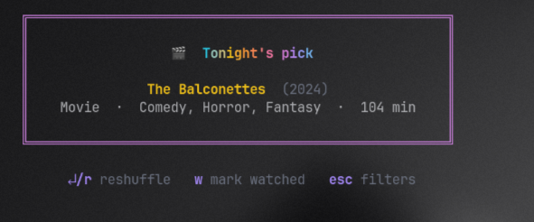
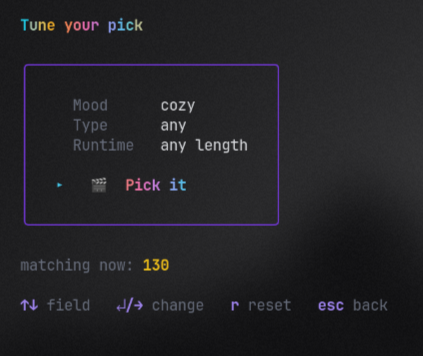
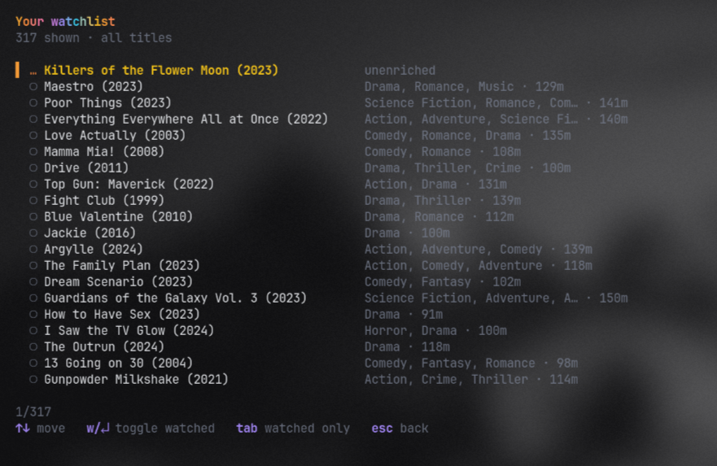
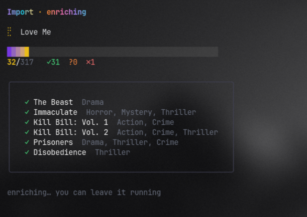

# whatnext

<p>
  <a href="https://github.com/jarvis1704/whatnext/releases/latest"></a>
  <a href="https://github.com/jarvis1704/whatnext/blob/main/LICENSE"></a>
  
  
</p>

Stuck scrolling your Letterboxd watchlist every night? **whatnext** picks for
you — filtered by genre, mood, media type, runtime, or streaming provider —
in a fast, animated terminal app written in Go.

Run it with **no arguments** for the full-screen interactive TUI, or use the
classic subcommands for scripting.

<p align="center">
  
</p>

## Install

Prebuilt binaries for every release live on the
[Releases page](https://github.com/jarvis1704/whatnext/releases/latest).

### Linux

```bash
curl -sSL https://github.com/jarvis1704/whatnext/releases/latest/download/whatnext_linux_amd64.tar.gz \
  | tar -xz whatnext
sudo install whatnext /usr/local/bin/whatnext
```

Use `whatnext_linux_arm64.tar.gz` on an ARM machine (e.g. Raspberry Pi).

### macOS

```bash
curl -sSL https://github.com/jarvis1704/whatnext/releases/latest/download/whatnext_darwin_arm64.tar.gz \
  | tar -xz whatnext
sudo install whatnext /usr/local/bin/whatnext
```

Use `whatnext_darwin_amd64.tar.gz` on an Intel Mac. The binary is unsigned,
so on first run macOS Gatekeeper may block it — allow it via **System
Settings → Privacy & Security**, or run `xattr -d com.apple.quarantine
/usr/local/bin/whatnext` once.

### Windows

```powershell
Invoke-WebRequest -Uri https://github.com/jarvis1704/whatnext/releases/latest/download/whatnext_windows_amd64.zip -OutFile whatnext.zip
Expand-Archive whatnext.zip -DestinationPath .
```

Then move `whatnext.exe` to a folder on your `PATH`. ARM64 devices should use
`whatnext_windows_arm64.zip`.

### Verify the download (optional)

Every release also publishes `checksums.txt`:

```bash
curl -sSLO https://github.com/jarvis1704/whatnext/releases/latest/download/checksums.txt
sha256sum --ignore-missing -c checksums.txt
```

### With Go installed

```bash
go install github.com/jarvis1704/whatnext@latest
```

### From source

```bash
git clone https://github.com/jarvis1704/whatnext.git
cd whatnext
go build -o whatnext .
```

Requires Go 1.22+. Dependencies are the [Charm](https://charm.sh) TUI stack
(Bubble Tea / Lip Gloss / Bubbles).

## Setup

1. **TMDb API key** (for genre/runtime enrichment — free v3 key):
   ```bash
   export TMDB_API_KEY="your-key-here"
   ```
   Without it, import and pick still work; enrichment is simply skipped.

2. **Letterboxd export**: Letterboxd → Settings → Import & Export → Export Data.
   Import the `.zip` directly — no need to unzip.

## Interactive TUI

```bash
./whatnext
```

- **🎲 Pick something** — tune mood / type / runtime / streaming provider,
  then a slot-machine reveal lands on a random unwatched title.
- **🗂 Browse pool** — scroll your watchlist, `/` to live-search by name,
  toggle watched with `w`.
- **📥 Import export** — point it at a `.zip` or `watchlist.csv`.
- **✨ Refresh enrichment** — retry TMDb lookups for unenriched titles, with a
  live progress bar.
- **📊 Stats** — genre breakdown, decade histogram, avg runtime.
- **🌍 Region** — set the country used for "where to watch" lookups.

Keys: arrows / `j`/`k` to move, `↵` to select, `esc` to go back, `q` to quit.

<table>
  <tr>
    <td align="center" width="50%">
      <br>
      <sub>Tune mood, type, and runtime — watch the match count update live</sub>
    </td>
    <td align="center" width="50%">
      <br>
      <sub>Browse the full pool, live-search, toggle watched</sub>
    </td>
  </tr>
  <tr>
    <td align="center" width="50%">
      <br>
      <sub>Import a Letterboxd export and enrich in the background</sub>
    </td>
    <td align="center" width="50%">
      <br>
      <sub>The reveal — reshuffle, mark watched, or head back to filters</sub>
    </td>
  </tr>
</table>

## Subcommands

```bash
./whatnext import ~/Downloads/letterboxd-export.zip
./whatnext pick --mood intense --max-runtime 120
./whatnext pick --genre Thriller --type movie
./whatnext pick --on Netflix
./whatnext list [--watched] [--on <provider>]
./whatnext watched "Paddington 2"
./whatnext stats
./whatnext region [<code>]
./whatnext refresh
./whatnext doctor
```

### `doctor`

One-shot health check — run it first if enrichment misbehaves:

```
whatnext doctor

  ✓ API key      set (32 chars)
  ✓ DNS          api.themoviedb.org → 3.175.86.67
  ✓ TMDb API     reachable, key valid (142ms)
  ✓ Pool         214 titles · 30 watched · 3 unenriched  ~/.whatnext
```

It flags a missing/rejected key, and detects **ISP DNS-hijack block pages**
(common in India — TMDb resolves to a `49.44.x.x` block IP). Fix: point your
resolver at `1.1.1.1` / `8.8.8.8`. Exits non-zero on any hard failure, so it's
safe to gate scripts on.

## Storage

Everything lives in `~/.whatnext/`:

- `data.json` — your enriched watchlist pool
- `moods.json` — editable mood → genre mapping (add your own, e.g.
  `"rainy-day": ["Drama", "Romance"]`)

Re-importing an updated export is always safe: titles dedupe by Letterboxd URI,
so existing enrichment and watched flags are never clobbered.
